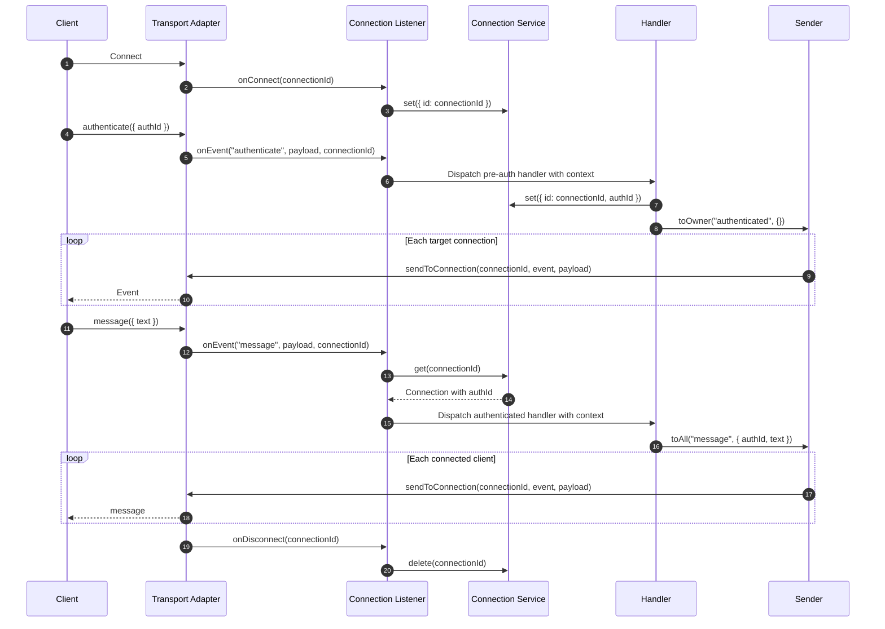

# v11 Networking Design

v11 keeps the v10 intent but makes the wrapper transport-neutral. It forwards connection events to a listener, dispatches commands through handler maps, builds each handler's context, and sends events through the transport.

## Wiring

- Declare pre-auth and authenticated commands, outgoing events, contexts, and handler maps with the existing TypeScript types.
- On connect, store `{ id: connectionId }`. The `authenticate` handler validates the supplied `authId` and stores `{ id: connectionId, authId }`. On disconnect, remove the connection.
- `createConnectionListener` uses the connection record to route pre-auth commands to the pre-auth handler group and authenticated commands to the authenticated group.
- Each handler group builds its own context. The pre-auth context has the connection ID and an owner-only sender; the authenticated context has the saved `authId` and a sender.
- `createSender` implements `toOwner`, `toUser`, `toOthers`, and `toAll` by resolving connection IDs and calling the transport's `sendToConnection`.
- A transport adapter implements `start`, `stop`, and sending to one connection. It passes the connection ID with every inbound command. It does not contain application handlers.

The sender's recipient meanings are consistent across transports: `toOwner` targets the current connection, `toUser` targets every connection with the matching `authId`, `toOthers` targets every other connection, and `toAll` targets every connection. A transport such as WebRTC can be used if it can send to the connection IDs managed by the application.

## Sequence

